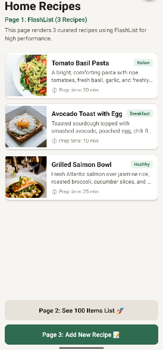

# Home Recipes 🍳📱

A modern cross-platform mobile application built with **React Native** and **Expo**. **Home Recipes** is designed to explore mobile UI patterns, list rendering performance comparisons, form interactions, and enterprise mobile deployment architecture.



---

## 🚀 About the Project

This project is created as part of learning and mastering React Native by following the official **[React Native Roadmap](https://roadmap.sh/react-native)** with a study group at **Parser Digital**, organized by **Joaquim Ley** and **Rafael Guevara**.

### 📱 Pages Included

- **Page 1 (Home Recipes):** High-performance rendering of 3 curated recipes using `@shopify/flash-list`.
- **Page 2 (Scroll Benchmark):** Rendering 100 recipe items using `ScrollView` and `.map()` to observe list loading and rendering behavior.
- **Page 3 (Add Recipe):** Interactive recipe creation form with custom input fields and toast feedback.

---

## 🏛️ Advanced Architecture Topics (Workshop Homework)

### 1. App Stores vs. Over-The-Air (OTA) Updates

Mobile app updates are split into two deployment pipelines: **Binary App Store Releases** and **EAS OTA Updates**.

| Feature | App Store / Play Store Binary Release | EAS Over-The-Air (OTA) Update |
| :--- | :--- | :--- |
| **Delivery Channel** | Apple App Store & Google Play Store | EAS Update CDN directly to user devices |
| **Review Process** | Requires Apple / Google store review (12h - 48h) | Instant deployment (seconds / minutes) |
| **What can change?** | JS Bundle, Assets, Native Code (C++, Swift, Kotlin), Native Dependencies, App Config | JavaScript bundle, React components, CSS/styles, images/static assets |
| **Native Boundary** | Changes native binary, permissions (`AndroidManifest.xml`, `Info.plist`), SDK upgrades | **NO native code changes allowed**. Cannot add native libraries with new native code. |

#### ⚠️ Rule of Thumb for OTA Updates
> **Allowed in OTA:** Fixing JS bugs, changing UI styles, updating copy, modifying business logic.  
> **Requires App Store Submission:** Upgrading Expo SDK, adding native packages (e.g. `react-native-camera`), modifying native config plugins (`app.json`).

---

### 2. Expo Brownfield Architecture

**Brownfield Integration** refers to embedding React Native / Expo screens inside an **existing native iOS (Swift/Obj-C) or Android (Kotlin/Java)** codebase, as opposed to a **Greenfield** app written entirely in React Native from scratch.

#### Key Approaches to Brownfield with Expo:
1. **Isolated View Approach (`ReactFragment` / `ReactController`):**
   - The native app manages navigation, bottom tabs, and core screens.
   - Expo/React Native views are embedded as native fragments (`ReactFragment` on Android) or view controllers (`UIViewController` on iOS) for specific features (e.g. recipe feed, checkout flow).
2. **Integrated Navigation Approach (`@callstack/react-native-brownfield`):**
   - Shared navigation stack where native screens can push React Native screens and vice versa.
3. **Expo Continuous Native Generation (CNG):**
   - Expo manages native directories (`ios/` and `android/`) via prebuild plugins, enabling seamless Expo library usage even in brownfield setups.

---

## 🛠️ How to Use Expo & React Native

### Prerequisites

Ensure you have **Node.js** (v18+) installed on your system.

### 1. Install Dependencies

```bash
npm install
```

### 2. Start the Development Server

```bash
npx expo start
```

Once the dev server starts, you can choose how to run the app:

- Press `a` to open in an **Android Emulator**
- Press `i` to open in an **iOS Simulator**
- Press `w` to open in a **Web Browser**
- Scan the QR code using the **[Expo Go](https://expo.dev/go)** app on your mobile device

---

## 📜 Available Scripts

- `npm run start` – Start the Expo development server
- `npm run android` – Run on Android emulator
- `npm run ios` – Run on iOS simulator
- `npm run web` – Run on web browser
- `npm run lint` – Run ESLint to check code quality
- `npx tsc --noEmit` – Run TypeScript type checking

---

## 📚 Resources & References

- 🗺️ **React Native Roadmap:** [roadmap.sh/react-native](https://roadmap.sh/react-native)
- 📖 **Expo Documentation:** [docs.expo.dev](https://docs.expo.dev/)
- 🔀 **Expo Router Docs:** [docs.expo.dev/router/introduction](https://docs.expo.dev/router/introduction/)
- ⚡ **Shopify FlashList Docs:** [shopify.github.io/flash-list](https://shopify.github.io/flash-list/)
